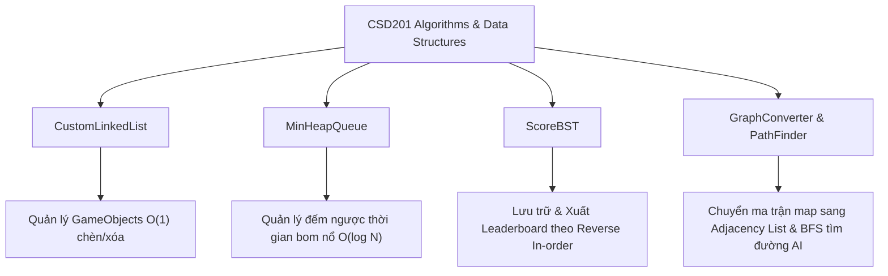

# 💣 CSD201 - BOMBERMAN GAME

> **Đồ án môn học:** Cấu trúc Dữ liệu và Giải thuật (Data Structures and Algorithms - CSD201)  
> **Đơn vị đào tạo:** Đại học FPT (FPT University)  
> **Ngôn ngữ & Nền tảng:** Java SE 21+, Java Swing / AWT, Maven

---

## 👥 Nhóm Thực Hiện (Development Team)

| STT | Mã số sinh viên | Họ và tên | Vai trò |
| :---: | :---: | :--- | :--- |
| 1 | **CE200304** | **Nguyễn Trần Khả Nhân** | **Leader** |
| 2 | CE201492 | Lương Trung Hiếu | Thành viên |
| 3 | CE201621 | Nguyễn Minh Phát | Thành viên |
| 4 | CE201183 | Đỗ Trần Thiên Phúc | Thành viên |
| 5 | CE201665 | Lê Nguyễn Thành Tài | Thành viên |
| 6 | CE201233 | Trương Anh Tuấn | Thành viên |

---

## 📖 Giới Thiệu Dự Án (Overview)

**CSD201 - Bomberman** là phiên bản làm lại của trò chơi đặt bom kinh điển kết hợp việc áp dụng thực tế các **Cấu trúc dữ liệu và Giải thuật (Data Structures & Algorithms)** nâng cao. Người chơi vào vai nhân vật Bomberman với nhiệm vụ di chuyển khéo léo, đặt bom phá vỡ các khối gạch cản đường, tiêu diệt quái vật và đánh bại Boss cuối cùng để qua màn.

Trò chơi được xây dựng bằng **Java thuần (Java Swing / Graphics2D)**, không phụ thuộc vào game engine bên thứ ba, nhằm minh chứng khả năng tổ chức mã nguồn hướng đối tượng (OOP) và triển khai cấu trúc dữ liệu thủ công từ số 0 (from scratch).

---

## 🧠 Cấu Trúc Dữ Liệu & Giải Thuật (DSA Implemented)

Đây là trọng tâm học thuật chính của đồ án CSD201:



### 1. Danh Sách Liên Kết Đôi (`CustomLinkedList.java`)
- **Mục đích:** Quản lý vòng đời của tất cả các thực thể trong trò chơi (`GameObject`: Player, Enemy, SmartEnemy, Boss, Bomb, Flame, ExitDoor).
- **Ưu điểm:**
  - Thêm một đối tượng mới vào cuối danh sách (`addLast`) với chi phí thời gian $O(1)$.
  - Xóa đối tượng bất kỳ (`removeNode`) như quái chết, lửa nổ hết hạn, bom đã kích hoạt với chi phí $O(1)$ khi đã giữ tham chiếu node, vượt trội hơn so với mảng động (`ArrayList`) vốn tốn $O(N)$ khi dồn mảng.

### 2. Hàng Đợi Ưu Tiên Min-Heap (`MinHeapQueue.java`)
- **Mục đích:** Quản lý danh sách các quả bom đang đếm ngược trên sàn đấu theo thời gian phát nổ (`timeToExplode`).
- **Cơ chế:**
  - Tự hiện thực Heap trên nền mảng với các phép toán `heapifyUp` (khi thêm bom mới) và `heapifyDown` (khi lấy bom nổ ra).
  - Quả bom có thời gian kích nổ sớm nhất luôn nằm ở gốc (`root`).
  - Kiểm tra bom nổ (`peek`) đạt $O(1)$, thêm/lấy bom (`enqueue`/`dequeue`) đạt $O(\log N)$.

### 3. Cây Nhị Phân Tìm Kiếm (`ScoreBST.java`)
- **Mục đích:** Lưu trữ và quản lý bảng điểm cao (Leaderboard/High Scores).
- **Cơ chế:**
  - Mỗi node trên cây lưu `name` và `score`.
  - Phép chèn điểm số mới vào cây đạt độ phức tạp trung bình $O(\log N)$.
  - **Duyệt cây theo thứ tự Đảo chiều (Reverse In-Order Traversal: Right $\rightarrow$ Node $\rightarrow$ Left):** Giúp trích xuất danh sách người chơi theo thứ tự điểm số giảm dần cực kỳ nhanh chóng mà không cần tốn tài nguyên sắp xếp mảng phụ.
  - Tích hợp tự động lưu và tải dữ liệu từ tệp tin `highscore.txt`.

### 4. Đồ Thị & Thuật Toán BFS Tìm Đường (`GraphConverter.java` & `PathFinder.java`)
- **Mục đích:** Xây dựng trí tuệ nhân tạo (AI) cho quái thông minh (`SmartEnemy`) và Trùm cuối (`Boss`).
- **Cơ chế:**
  - `GraphConverter`: Quét ma trận bản đồ ($13 \times 25$) và biến đổi các ô đường đi khả dụng thành danh sách kề (`adjacencyList`).
  - `PathFinder`: Sử dụng giải thuật **Tìm kiếm theo chiều rộng (Breadth-First Search - BFS)** để tìm ra đường đi ngắn nhất (Shortest Path) từ quái vật đến vị trí tọa độ của Player trong thời gian thực.
  - **Dynamic Obstacle Avoidance:** Xem vị trí các quả bom như bức tường chắn tạm thời (`generateMapWithBombs()`), quái thông minh sẽ không đâm đầu vào bom.
  - **Fallback Logic:** Nếu không tìm được đường tới người chơi (bị tường ngăn cách hoàn toàn), quái vật tự động chuyển sang chế độ di chuyển ngẫu nhiên để không bị đứng khựng.

---

## 🎮 Tính Năng & Hệ Thống Màn Chơi (Gameplay & Levels)

| Màn chơi | Tên màn | Đặc điểm & Thử thách | Số lượng & Loại quái |
| :---: | :--- | :--- | :---: |
| **Map 1** | **Default / Classic** | Màn khởi động. Tường gạch bố trí vừa phải. Làm quen với cơ chế đặt bom và né nổ. | 4 Quái thường (`Enemy`) - Đi ngẫu nhiên khi gặp ngã rẽ |
| **Map 2** | **Smart Enemy / Volcano** | Màn nâng cao với phong cách địa hình nham thạch rực lửa. Quái vật sở hữu AI tìm đường thông minh. | 5 Quái thông minh (`SmartEnemy`) - Tự săn lùng Player qua BFS |
| **Map 3** | **Boss Battle** | Trận đấu trùm kịch tính! Bản đồ rộng lớn, Boss có thanh máu HP, thời gian bất tử ngắn sau khi nhận sát thương, và chiêu thức đặc biệt. | 1 **Boss** tối thượng + Quái hỗ trợ |

### ⭐ Các Cơ Chế Đặc Sắc Khác:
- **Boss Special Skill:** Cứ mỗi 15 giây, Boss kích hoạt kỹ năng đặc biệt, tự động chọi **2 quả bom hẹn giờ** vào sát vị trí đứng của người chơi. Lửa nổ của Boss có màu tím độc tính cao!
- **Cơ Chế Cửa Thoát Hiểm (Exit Door):** Tiêu diệt toàn bộ kẻ địch trong màn để mở cánh cổng chiến thắng. Bước qua cổng sẽ đưa người chơi tới màn kế tiếp và **tặng thêm 1 Mạng sống (+1 Life)**.
- **Hỗ Trợ Di Chuyển Mượt Mà (Corner Sliding Assist):** Tự động căn chỉnh và lướt nhẹ khi người chơi di chuyển vướng góc mép tường gạch hoặc mép bom (Threshold 18px), loại bỏ cảm giác giật khựng thường gặp ở các game lưới vuông 2D.
- **Camera Theo Dõi Mượt Mà (Scrolling Camera):** Bản đồ có chiều rộng 25 ô (lớn hơn khung hình hiển thị 15 ô), camera luôn lấy người chơi làm trung tâm một cách linh hoạt.
- **Hệ Thống Đồ Họa & Âm Thanh Đầy Đủ:**
  - Hiệu ứng khói nổ hình đám mây nấm hạt nhân (Nuclear Mushroom Cloud) vẽ bằng thuật toán `Path2D` kèm cơ chế làm mờ dần (Fade out).
  - Âm thanh sống động: Nhạc nền riêng biệt cho từng Map (Theme 1, Theme 2, Theme 3), nhạc Menu, âm thanh đặt bom, bom nổ, quái chết, nhận sát thương, chiến thắng và thất bại.

---

## ⌨️ Hướng Dẫn Điều Khiển (Game Controls)

### Trong trận đấu:
| Phím | Hành động |
| :---: | :--- |
| <kbd>W</kbd> | Di chuyển lên trên (Move Up) |
| <kbd>S</kbd> | Di chuyển xuống dưới (Move Down) |
| <kbd>A</kbd> | Di chuyển sang trái (Move Left) |
| <kbd>D</kbd> | Di chuyển sang phải (Move Right) |
| <kbd>SPACE</kbd> | Đặt bom (Tối đa 2 quả bom đồng thời) |
| <kbd>P</kbd> | Tạm dừng trò chơi (Pause) / Tiếp tục (Resume) |
| <kbd>ESC</kbd> | Thoát trận đấu về Menu chính |

### Trong Menu / Màn hình giao diện:
| Phím | Hành động |
| :---: | :--- |
| <kbd>W</kbd> / <kbd>S</kbd> | Di chuyển lựa chọn Menu lên / xuống |
| <kbd>A</kbd> / <kbd>D</kbd> | Đổi trang Hướng dẫn (Tutorial) / Chọn màn chơi (Select Map) |
| <kbd>ENTER</kbd> | Xác nhận lựa chọn / Bắt đầu chơi / Chơi lại khi thua |
| <kbd>ESC</kbd> | Quay về Menu trước đó |

---

## 📂 Cấu Trúc Thư Mục Dự Án (Project Structure)

```text
CSD201-Boomber-Man/
│
├── pom.xml                                    # Cấu hình dự án Apache Maven
├── highscore.txt                              # Tệp tin lưu trữ dữ liệu điểm cao
├── README.md                                  # Tài liệu hướng dẫn dự án
│
└── src/
    └── main/
        ├── java/
        │   ├── algorithm/                     # CÁC CẤU TRÚC DỮ LIỆU & GIẢI THUẬT
        │   │   ├── CustomLinkedList.java      # Danh sách liên kết đôi tự cài đặt
        │   │   ├── MinHeapQueue.java          # Hàng đợi ưu tiên Min-Heap quản lý bom
        │   │   ├── ScoreBST.java              # Cây nhị phân tìm kiếm lưu bảng điểm
        │   │   ├── GraphConverter.java        # Chuyển đổi lưới ma trận thành Đồ thị
        │   │   ├── PathFinder.java            # Giải thuật BFS tìm đường ngắn nhất
        │   │   └── GridPoint.java             # Cấu trúc điểm lưới tọa độ (row, col)
        │   │
        │   ├── com/mycompany/csd201_bommerman/
        │   │   └── CSD201_BommerMan.java      # Lớp chứa hàm main() khởi chạy Game
        │   │
        │   ├── config/                        # CẤU HÌNH TRÒ CHƠI
        │   │   ├── LevelConfig.java           # Định nghĩa cấu hình từng màn chơi
        │   │   └── LevelManager.java          # Quản lý danh sách cấp độ & mở khóa màn
        │   │
        │   ├── core/                          # HỆ THỐNG ĐIỀU HÀNH LÕI
        │   │   ├── GamePanel.java             # Vòng lặp game loop (60 FPS), logic & vẽ
        │   │   ├── GameState.java             # Enum các trạng thái (MENU, PLAYING,...)
        │   │   ├── KeyHandler.java            # Bộ lắng nghe sự kiện bàn phím
        │   │   ├── CollisionChecker.java      # Xử lý va chạm vật thể, tường, bom
        │   │   ├── BombManager.java           # Điều phối đặt, đếm ngược & nổ bom
        │   │   ├── SoundManager.java          # Quản lý phát nhạc BGM & hiệu ứng SFX
        │   │   ├── AssetManager.java          # Quản lý nạp ảnh Sprite & ảnh động GIF
        │   │   └── UIManager.java             # Vẽ các màn hình giao diện (HUD, Menu,...)
        │   │
        │   ├── map/                           # BẢN ĐỒ
        │   │   └── MapManager.java            # Nạp và vẽ ma trận bản đồ từ file txt
        │   │
        │   └── model/                         # MÔ HÌNH THỰC THỂ (OBJECT MODELS)
        │       ├── GameObject.java            # Lớp trừu tượng cha của mọi thực thể
        │       ├── IdObject.java              # Định danh đối tượng (PLAYER, ENEMY,...)
        │       ├── Player.java                # Nhân vật người chơi Bomberman
        │       ├── Enemy.java                 # Quái vật thường
        │       ├── SmartEnemy.java            # Quái vật thông minh (BFS AI)
        │       ├── Boss.java                  # Trùm Map 3 với kỹ năng ném bom
        │       ├── Bomb.java                  # Đối tượng quả bom hẹn giờ
        │       ├── Flame.java                 # Đối tượng tia lửa nổ
        │       └── ExitDoor.java              # Cánh cửa chuyển màn chơi
        │
        └── resources/                         # TÀI NGUYÊN (ASSETS)
            ├── maps/                          # File ma trận bản đồ text (map01, map02, map03)
            ├── sounds/                        # Âm thanh hiệu ứng & nhạc nền (.wav)
            └── sprites/                       # Hình ảnh nhân vật, quái vật, bom, GIF hướng dẫn
```

---

## 🚀 Hướng Dẫn Cài Đặt & Chạy Game (Getting Started)

### 1. Yêu Cầu Môi Trường
- **Java Development Kit (JDK):** Phiên bản **21** trở lên.
- **Apache Maven:** Phiên bản 3.8+ (khuyên dùng).
- **IDE đề xuất:** Apache NetBeans 19+, IntelliJ IDEA, Eclipse, hoặc Visual Studio Code.

### 2. Chạy Bằng Apache NetBeans (Khuyên dùng)
1. Mở **NetBeans**.
2. Chọn `File` $\rightarrow$ `Open Project...` và trỏ đến thư mục chứa dự án: `CSD201-Boomber-Man`.
3. Chờ NetBeans nạp xong các thư viện Maven.
4. Nhấn chuột phải vào dự án chọn **Clean and Build**.
5. Nhấn phím <kbd>F6</kbd> (hoặc nút **Run Project**) để thưởng thức trò chơi!

### 3. Chạy Bằng Dòng Lệnh (Command Line / Terminal)
1. Mở Terminal / PowerShell tại thư mục gốc của dự án:
   ```bash
   cd c:/Users/HPs/OneDrive/Desktop/LAB211/CSD201-Boomber-Man
   ```
2. Biên dịch và đóng gói bằng Maven:
   ```bash
   mvn clean package
   ```
3. Chạy trực tiếp qua Maven Exec Plugin:
   ```bash
   mvn exec:java -Dexec.mainClass="com.mycompany.csd201_bommerman.CSD201_BommerMan"
   ```
   *Hoặc chạy file JAR sau khi build:*
   ```bash
   java -jar target/CSD201_BommerMan-1.0-SNAPSHOT.jar
   ```

---

## 🏆 Đánh Giá Độ Phức Tạp Thuật Toán (Complexity Analysis)

| Chức năng | Thuật toán / Cấu trúc dữ liệu | Thời gian (Time Complexity) | Không gian (Space Complexity) |
| :--- | :--- | :---: | :---: |
| Quản lý thực thể game | Doubly Linked List | $O(1)$ chèn cuối / xóa node | $O(N)$ số lượng thực thể |
| Lập lịch nổ bom | Min-Heap Priority Queue | $O(1)$ lấy bom sớm nhất, $O(\log K)$ thêm/xóa bom | $O(K)$ số bom đang hoạt động |
| Tìm đường quái vật AI | Breadth-First Search (BFS) | $O(V + E) = O(R \times C)$ với $R \times C$ là kích thước map | $O(R \times C)$ cho mảng visited & queue |
| Quản lý bảng xếp hạng | Binary Search Tree (BST) | $O(\log N)$ trung bình khi chèn | $O(N)$ số bản ghi điểm số |
| Trích xuất Top Leaderboard | Reverse In-Order Traversal | $O(N)$ duyệt toàn bộ cây theo thứ tự giảm dần | $O(H)$ với $H$ là chiều cao cây |
